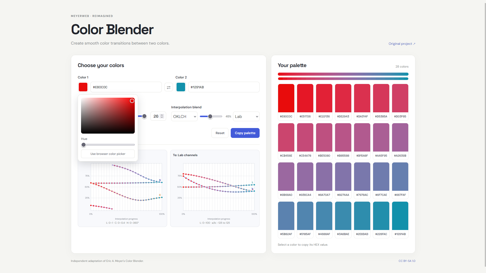

# MeyerWeb Color Blender Reimagined

A modern, independent adaptation of [Eric A. Meyer's original Color Blender](https://meyerweb.com/eric/tools/color-blend/).

The original Color Blender introduced a simple way to generate intermediate colors between two endpoints. This project preserves that core idea while rebuilding the interface and code with modern web technologies.

## Explore the Website

**[Open MeyerWeb Color Blender Reimagined](https://proyolo-ks1.github.io/MeyerWebColorBlenderReimagined/)**

No installation required. Explore directly in your browser.

## Features

- Blend between two colors.
- Choose the number of intermediate colors.
- Blend between RGB, Linear RGB, HSL, HSV, HWB, Lab, LCH, OKLab, and OKLCH interpolation styles.
- Compare channel graphs for the selected from/to spaces, including intermediate-color positions.
- Edit colors using HEX fields or the custom color picker, with an option to open the browser's native picker.
- Copy individual color values.
- Share a palette through its URL.
- Responsive, dependency-free interface built with vanilla HTML, CSS, and JavaScript.

## Run locally

The app uses native JavaScript modules, so open it through a local HTTP server rather than directly as a `file://` URL. For example, run `python -m http.server 8000` in the project folder, then visit `http://localhost:8000`.

## Code layout

- `js/color.js` contains color conversions and interpolation spaces.
- `js/charts.js` draws the interpolation graphs.
- `js/color-picker.js` handles the custom and native color pickers.
- `js/appearance.js` manages theme and background preferences.
- `js/copy-menu.js` handles palette export formats.
- `js/app.js` connects the modules and renders the palette.

## Project status

This is an independent, ongoing reimagining. It is not affiliated with or endorsed by Eric A. Meyer.

## Original project and attribution

- **Original author:** Eric A. Meyer
- **Original project:** [MeyerWeb Color Blender](https://meyerweb.com/eric/tools/color-blend/)
- **Original license:** [Creative Commons Attribution-ShareAlike 1.0](https://creativecommons.org/licenses/by-sa/1.0/)

This project is an adaptation of the original Color Blender. The original author retains copyright in their original work. Changes and additions made for this reimagining are attributable to the contributors who made them.

## License

This derivative project is distributed under the same **Creative Commons Attribution-ShareAlike 1.0** license as the original.

See the [CC BY-SA 1.0 license](https://creativecommons.org/licenses/by-sa/1.0/) for the complete terms. If you redistribute or adapt this project, preserve the attribution and license information and distribute adaptations under the same license.

The license notice applies to the project code derived from the original. Any separately sourced assets may have their own licenses.

-# like eastereggs? try 
